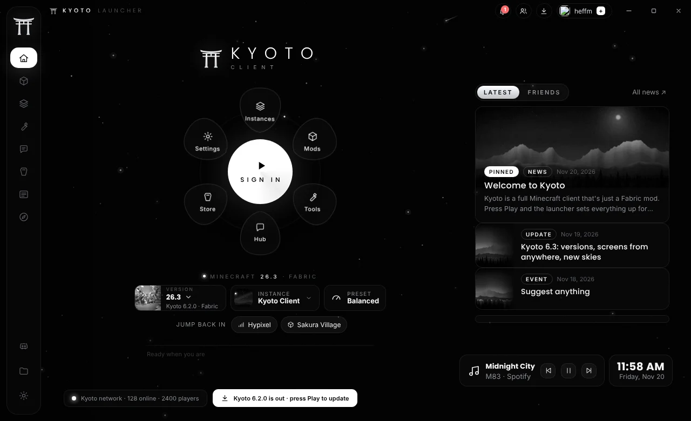

  

<h1 align="center">K Y O T O &nbsp; C L I E N T</h1>

<b>The best client is just a mod.</b> 
A free Minecraft client for <b>26.3</b>, built on Fabric. Black and white, starry, minimal and fast.

  <a href="https://github.com/kyotoclient/kyoto-server/releases/download/v7.0.0/Kyoto.Launcher.exe"><b>⬇ Download the launcher (Windows)</b></a>
  &nbsp;·&nbsp;
  <a href="https://github.com/kyotoclient/kyoto-server/releases/download/v7.0.0/kyoto-26.3.jar">Just the mod (.jar)</a>
  &nbsp;·&nbsp;
  <a href="https://kyoto-server.onrender.com">Website</a>

  

---

## Why Kyoto

Most clients replace Minecraft. Kyoto doesn't: it's a single Fabric mod. That means it works with your other mods, your resource packs and shaders, and with every server you already play on.

- **Free forever.** No ads, no paywalled basics.
- **100% legit.** No X-ray, no reach, nothing bannable. Safe on Hypixel and any other server.
- **Just a mod.** Drop it next to Fabric API, or let the launcher set everything up for you.

## The look

Kyoto is black and white with a night sky behind everything, and a torii gate as its symbol. Nothing changes with the seasons; on holidays only the torii does (a star at Christmas, a heart on Valentine's, a moon at Halloween).

- **Petal menu.** Press <kbd>Right Shift</kbd> and your settings open as a flower around your head.
- **Petal title screen.** Singleplayer, Multiplayer and Options become petals around the torii, with Kyoto's own buttons tucked in between.
- **Custom loading screen.** The torii builds itself on a starry sky while Minecraft loads.
- **Every menu restyled.** Pause, Options, Singleplayer and Multiplayer all get thin, glassy Kyoto buttons and sliders (Realms is left alone, and server icons stay exactly as they are).
- **Particles.** Player trails (Ribbon, Stardust, Comet), white Sakura petals drifting around you, and floating motes of light.

## Features

**Gameplay & HUD**
- Fully movable HUD with snapping: FPS, CPS, keystrokes, armor, coordinates, potion timers, combo counter and more
- Zoom, freelook, toggle sprint, fullbright, low fire, hit colours, custom crosshair and block outline
- Replay buffer: save the last few seconds as a clip with one key
- Screenshot studio, waypoints, death markers, slime chunks

**Music & streaming**
- Spotify and "what's playing" on screen, lyrics in the sky, a music visualizer
- Stream overlays for OBS: live stats, challenges and alerts straight from your game

**Social**
- **Kyoto Hub**: chat channels, friends, DMs, voice notes, parties and reports
- See which friends are online and which server they're on
- Profiles with badges, widgets, a guestbook and your own page on the website

**Cosmetics**
- Capes (animated GIF capes too), hats, wings, auras and pets
- A cosmetics store with coins you earn from achievements

## Kyoto Launcher

A launcher that looks as good as the client:

- One **Play** button that installs Fabric, Fabric API and the right Kyoto build, and keeps them updated
- Several instances, several Minecraft accounts, and a skin changer with your own skin library
- **Modpacks**: import `.mrpack` and CurseForge packs, export your own instance as `.mrpack`
- Mod, resource pack and shader browser (Modrinth + CurseForge)
- Screenshot and clip gallery, Java manager, RAM advisor, startup speed report and disk cleanup
- Notifications, home widgets (clock, weather, what's playing) and offline mode
- Portable mode for USB sticks

## Install

**Easiest:** download [**Kyoto.Launcher.exe**](https://github.com/kyotoclient/kyoto-server/releases/download/v7.0.0/Kyoto.Launcher.exe), sign in with your own Minecraft account and press **Play**.

**Already use Fabric?** Put [**kyoto-26.3.jar**](https://github.com/kyotoclient/kyoto-server/releases/download/v7.0.0/kyoto-26.3.jar) in your `mods` folder next to **Fabric API**.

Windows may warn you the first time you run the launcher. Click **More info → Run anyway**.

## Kyoto Studio (work in progress)

A free 3D editor for skins and cosmetics. It's being rebuilt for the new look. In the meantime you can [try it in your browser](https://kyoto-server.onrender.com/builder).

---

<b>For developers: what's in this repo</b>

This repo is Kyoto's backend and website: a small Node.js server with **no dependencies**. It powers friends, the online count, the Hub, profiles, cosmetics and the launcher's update checks.

- `server.js` (+ `social.js`, `community.js`, `extras.js`, `web.js`): the API and the website
- `site/`: the website
- `jars/links.json`: tells the launcher which Kyoto build to download for each Minecraft version

**Login is safe.** It uses Mojang's own session check, the same way real Minecraft servers verify players, so your password and tokens never touch this server.

**Run it yourself:** install Node.js 18+, then run `node server.js` (port 8080 by default).
Environment variables: `PORT`, `DATA_DIR`. Secrets such as API keys and webhooks are only ever set as environment variables on the host, never in the code.

Kyoto Client is not affiliated with Mojang or Microsoft. Minecraft is a trademark of Mojang AB.
